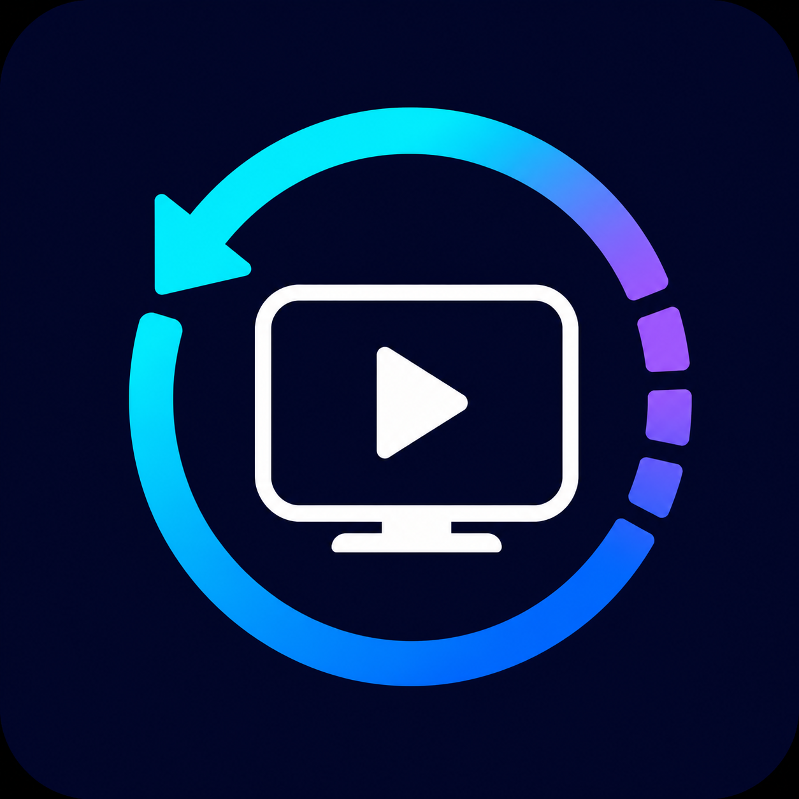

# 续映 ContinueBox

接续你的每一次观看。Android TV / 手机播放客户端，搭配自己的 Docker 同步服务器，保存历史、收藏与播放进度。

**公开版 2.2.5 · 同步服务端 0.27.1**

[下载 APK 与服务端](https://github.com/infinitytom/continuebox/releases/tag/v2.2.5) · [真实操作宣传视频](https://github.com/infinitytom/continuebox/releases/download/v2.2.5/ContinueBox-2.2.5-promo.mp4) · [源码与构建说明](docs/PUBLIC-BUILD.md)

## 本次更新

基于本地 2.2.4 整理为公开版，保留原生圆角卡片、遥控焦点、横竖屏布局、播放器选择、后台进度调度、邮箱注册、登录设备管理、聚合弹幕，以及离线旧登录记录移除等修复。

- 服务地址改为通用规则：公网域名默认 HTTPS；局域网 HTTP 未写端口时使用 8080；显式端口保持原值。
- 去掉作者私人域名的特殊端口映射，Emby 输入提示改为通用示例。
- 账号入口说明连接自己的服务器；安装包不预设作者的服务地址或账号。
- 服务端更新至 0.27.1，包含邮箱验证、设备会话撤销、持久化额度、请求限流与聚合弹幕。
- 发布对应的原生组件源码、208 个差异文件、完整 Apktool 工程、文件摘要和重建脚本。

宣传视频为安卓模拟器上的真实界面与操作录屏，使用独立演示账号和原创演示片；只有字幕和原创纯音乐，无配音。演示素材不随安装包内置，也不代表提供影视数据源。

## 使用

1. 在 Release 下载 `ContinueBox-2.2.5.apk`。Android 5.0+，ARM / ARM64；已有安装请先备份数据并核对签名。
2. 自行配置有权使用的数据源，或连接自己的 Emby。
3. 将服务端包解压到支持 Docker 的主机，运行 `sh install.sh`；Windows 使用 `install.ps1`。
4. 配置自己的 SMTP 后，新用户可用邮箱验证码注册；旧账号仍可用原账号密码登录。
5. 在“播放同步”填写自己的服务地址并登录，同一账号用于多台设备。

公网入口需要有效 HTTPS，后端 8080 仅用于受信任内网或反向代理。详细的服务配置、升级迁移和设备管理见 [服务端说明](sync-server/README-UPDATE.md)。升级保留 `.env`、`data/` 和原 `TOKEN_SECRET`。

## 源码与验证

本版本采用 Apktool 重建，`native-ui/` 是正在维护的 Kotlin/Java 组件；`client-patches/2.2.5/` 保存相对构建基包的全部资源与 Smali 差异。Release 同时提供完整解码工程、构建基包及 SHA256。

根目录的 `app/` 等目录是历史 Java 工程，直接运行根目录 Gradle 不会得到 2.2.5。当前引擎尚未全部迁移成可编译 Java/Kotlin 工程。请使用 [当前构建流程](docs/PUBLIC-BUILD.md)；旧版文档保留在 [历史说明](docs/LEGACY-README.md)。

本地验证：服务端 70 项、原生界面 88 项、账号与会话 99 项通过。安卓测试使用 x86 模拟器兼容测试包（去掉 ARM 原生库，保留本版 DEX 和资源）；ARM 真机兼容性仍需在具体设备验证。播放器内核、第三方服务和网络环境会影响实际播放体验。

## 许可与支持

客户端基于 [TVBoxOS](https://github.com/q215613905/TVBoxOS)，沿用 [GPL-3.0 许可证](LICENSE)。第三方组件遵循各自许可证。项目不提供影视源，请使用有权访问的内容。第三方令牌、邮箱授权码和本地数据不进入公开仓库。

如果续映对你有帮助，欢迎 Star，或请作者喝杯咖啡。

[linux.do](https://linux.do)
