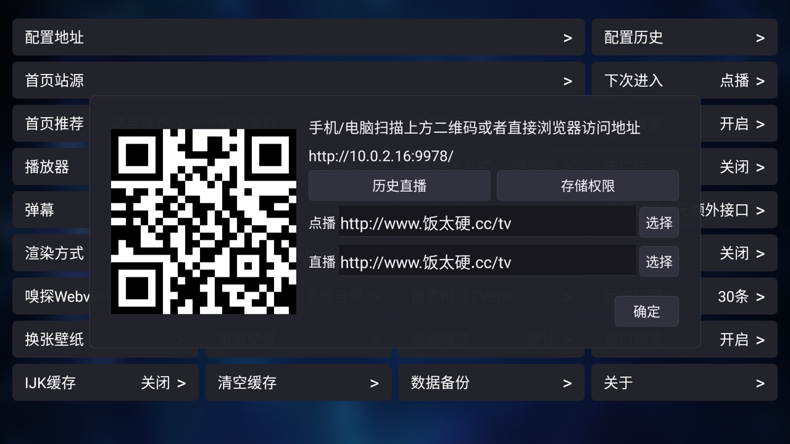

# 配置订阅与资源导航

## 饭太硬资源导航

[打开饭太硬资源导航](https://www.xn--sss604efuw.cc/)

该页面提供接口配置及相关资源入口。资源导航由第三方维护，地址和站点内容可能更新；当前地址请以导航页面公布的信息为准。

**普通 TVBox 同样可以使用此导航及兼容的订阅地址，并非续映专属资源。** 在支持 TVBox 配置格式的客户端中，将对应地址填入“配置地址 / 点播接口”即可；不同客户端和插件的兼容性可能不同。

本次演示使用用户指定的订阅地址：

```text
http://www.饭太硬.cc/tv
```

## 在续映中配置

1. 打开续映首页的“设置”，进入“配置地址”。
2. 在“点播”输入框粘贴上面的完整订阅地址，点击“确定”。电视端不便输入时，可扫描配置窗口中的二维码，在同一局域网的手机或电脑浏览器中发送地址。
3. 等待应用重新加载配置。首页左上角显示当前站点名称，顶部显示该站点提供的分类。
4. 如要浏览其他站点，进入“设置 → 首页站源”选择，再进入相应分类浏览。长按首页左上角的站点名称也可进入设置；短按会刷新配置缓存。
5. 直播地址按导航提供的直播配置单独填写；点播订阅地址不保证同时提供直播内容。



订阅加载、分类、海报、搜索与播放是否可用，取决于第三方站点、插件和网络情况。“配置已导入”不代表其中每个站点和每条播放线路都可用。

订阅地址只在演示环境和用户主动配置后使用；续映 APK 不预装此订阅，不提供或托管其中的影视内容。请访问有权使用的资源。
